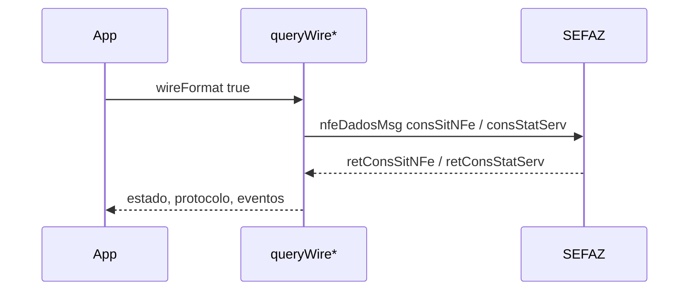

# queryWireDocumentSituation / queryWireServiceStatus

## Visão geral

Consultas no formato oficial: `queryNFeDocumentSituation({ wireFormat: true })` envia `consSitNFe` e `queryNFeServiceStatus({ wireFormat: true, issuerUF })` envia `consStatServ`, ambos em `nfeDadosMsg` (rota SP quando a UF é 35).

## Responsabilidades

- Recusar antes de enviar: ambiente inválido, chave malformada, `issuerUF` ausente, produção sem `requestExecutor`.
- Situação: `100`/`150` → `authorized`; `101`/`151` → `canceled`; `110`/`301`/`302` → `denied`; `217` → `not-found`; demais códigos → `inconclusive`. Devolve o protocolo de `protNFe/infProt`, o bloco `protNFe` bruto (`protocolXml`) e os eventos (`procEventoNFe/retEvento`: tipo, sequência, protocolo, `cStat`).
- `authorizer` opcional (`SVCAN`) consulta o autorizador de contingência; por padrão vale o da UF da chave.
- Recuperação do XML autorizado: com `signedXml` (NFe assinada, p.ex. reconstruída de forma determinística) e documento `authorized`, o resultado traz o `nfeProc` em `authorizedXml` somente se o `digVal` do protocolo for igual ao `DigestValue` da assinatura; caso contrário `authorizedXmlIssue: 'digest-mismatch'` e nenhum XML é montado.
- Status: `107` é sucesso; `108`/`109` são `unavailable`.

## Entradas e saídas

Entrada: os requests existentes com `wireFormat: true`. Saída: `DocumentSituationResult` (com `events`) e `ServiceStatusSnapshot`.

## Fluxo principal



## Tratamento de erros e casos-limite

Falhas de transporte (timeout, indisponibilidade) mantêm a classificação do transporte. Sem `wireFormat` vale o comportamento antigo.

## Exemplos

```ts
await queryNFeDocumentSituation({ accessKey, environment: 'production', requestExecutor, wireFormat: true });

// Recupera o nfeProc de um documento cuja resposta de autorização se perdeu
const { authorizedXml, authorizedXmlIssue } = await queryNFeDocumentSituation({
  accessKey, environment: 'production', requestExecutor, signedXml, wireFormat: true,
});
```

## Dependências e integrações

`nfe-query-payloads`, `resolveIssuerAuthorizer`, `executeNFeSoapService`, `operational-state`.
