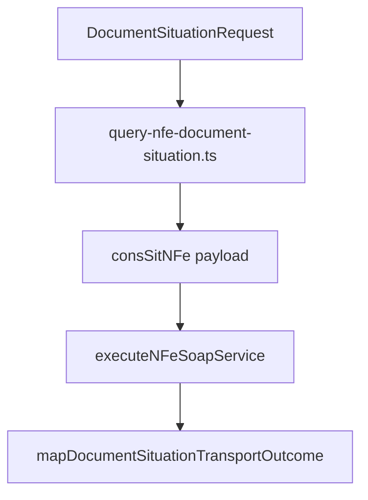

# src/canonical/nfe/query-nfe-document-situation.ts

## Visao geral

Orquestra a consulta estruturada da situacao do documento por chave de acesso.

## Responsabilidades

- Montar o payload minimo de `consSitNFe`.
- Acionar o servico homologado de situacao do documento.
- Traduzir respostas sem protocolo para `inconclusive`.

## Entradas e saidas

- Entradas: `DocumentSituationRequest`.
- Saidas: `Promise<DocumentSituationResult>`.

## Fluxo principal



## Tratamento de erros e casos-limite

- Resposta de sucesso sem protocolo e convertida em `inconclusive`.
- Os demais cenarios reaproveitam a classificacao do transporte.

## Exemplos

```ts
import { queryNFeDocumentSituation } from './query-nfe-document-situation.js';
```

## Dependencias e integracoes

- `../transport/execute-nfe-soap-service.js`
- `./contracts.js`
- `./transport-outcome-mapper.js`