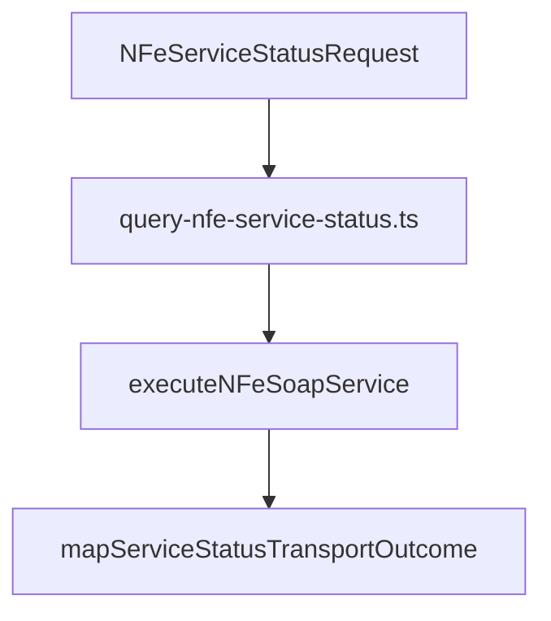

# src/canonical/nfe/query-nfe-service-status.ts

## Visao geral

Orquestra a consulta estruturada do status do servico de autorizacao de NFe.

## Responsabilidades

- Acionar o servico homologado `nfe-status-service`.
- Reaproveitar a classificacao do transporte.
- Materializar um snapshot observavel com timestamp.
- Registrar o ambiente informado na resposta `tpAmb`, para que a autorizacao SVC valide a evidencia usada.

## Entradas e saidas

- Entradas: `NFeServiceStatusRequest`.
- Saidas: `Promise<ServiceStatusSnapshot>`.

## Fluxo principal



## Tratamento de erros e casos-limite

- O fluxo reaproveita a classificacao do transporte para indisponibilidade, timeout e erro protocolar.
- O `authorizer` opcional permite consultar explicitamente o SVC-AN em producao; o snapshot informa `responseEnvironment` quando `tpAmb` e reconhecido.
- O timestamp observado e gerado no momento do mapeamento.

## Exemplos

```ts
import { queryNFeServiceStatus } from './query-nfe-service-status.js';
```

## Dependencias e integracoes

- `../transport/execute-nfe-soap-service.js`
- `./contracts.js`
- `./transport-outcome-mapper.js`