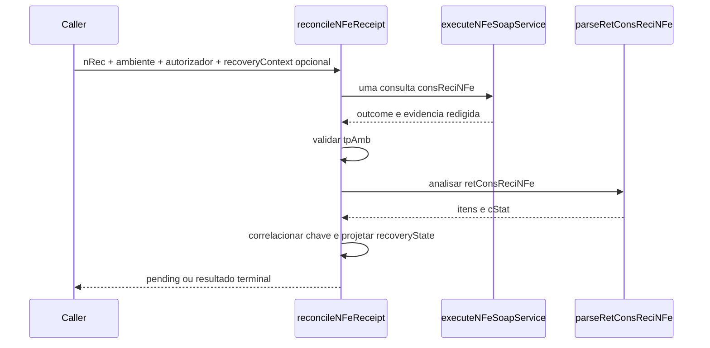

# reconcile-nfe-receipt.ts

## Visao geral

Consulta uma unica vez um recibo `nRec` conhecido e converte a resposta do servico assíncrono de autorizacao em classificacao operacional NF-e.

## Responsabilidades

- Montar `consReciNFe` para o ambiente solicitado.
- Encaminhar ambiente e autorizador explicitamente ao transporte SOAP.
- Validar `tpAmb`, estado do lote e consistencia do protocolo terminal.
- Preservar evidencia de transporte ja sanitizada e os estados operacionais existentes.
- Projetar o contexto caller-owned de contingencia/recovery sem alterar a classificacao do recibo.

## Entradas e saidas

- Entrada: `NFeReceiptReconciliationRequest`, com `receiptNumber`, `routingContext`, `recoveryContext` opcional, executor e timeout.
- Saida: `Promise<NFeReceiptReconciliationResult>` com classificacao original, estado de recovery, correlacao, proxima acao, estado operacional e outcome de transporte.

## Fluxo principal



## Tratamento de erros e casos-limite

- Recibo vazio resulta em `usage-error` sem transporte.
- `tpAmb` ausente ou diferente do ambiente solicitado resulta em `protocol-error`.
- XML sem estrutura ou status de lote reconhecido resulta em `protocol-error`.
- Autorizacao terminal sem `nProt` resulta em `protocol-error`.
- `timeout` e `unavailable` nao provocam reenvio da NF-e, polling ou troca automatica de autorizador.
- O resultado `pending` continua distinto de falhas e resultados terminais.
- Contexto EPEC exige protocolo de evento valido; chave retornada divergente produz `recoveryState: inconclusive` sem mudar a classificacao do recibo.
- Resultado autorizado correlacionado projeta `reconciled`; rejeicao/denegacao projeta `rejected`; indisponibilidade projeta `unavailable`.
- `nextAction` pode indicar uma nova chamada explicita a `reconcileNFeReceipt`; nao executa polling automaticamente.

## Exemplos

```ts
const result = await reconcileNFeReceipt({
  receiptNumber: '135190000000002',
  routingContext: { authorizer: 'SP', environment: 'production' },
  requestExecutor,
});
```

## Dependencias e integracoes

- `../transport/execute-nfe-soap-service.js`
- `./async-batch-retrieval.js`
- `./contracts.js`
- `./operational-state.js`
