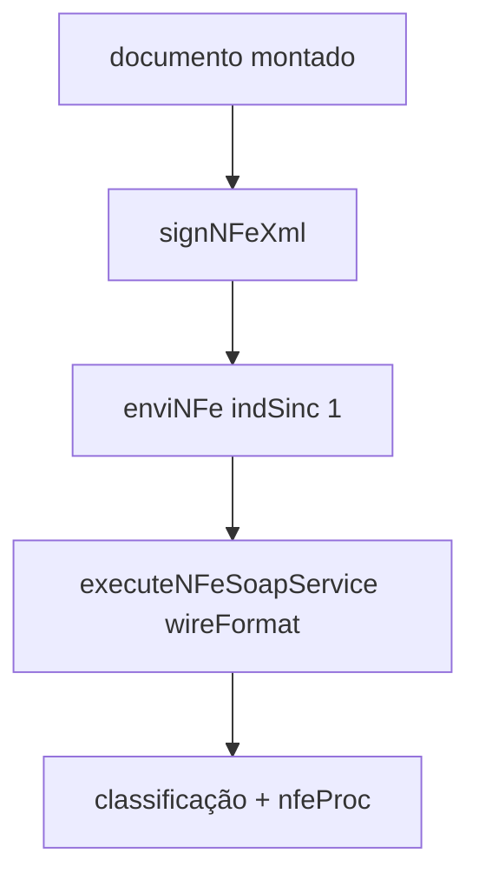

# submit-built-document

## Visão geral

Assina um documento montado, envia o `enviNFe` síncrono ao autorizador e classifica a resposta.

## Responsabilidades

Passo comum ao fluxo normal e à contingência SVC-AN de `authorizeNFe` com `built-document`. Devolve `signedXml` e, se autorizado, o `authorizedXml` (`nfeProc`).

## Entradas e saídas

Entrada: requisição, documento montado, ambiente e autorizador opcional (`SVCAN`). Saída: `NFeAuthorizationOutcome`.

## Fluxo principal



## Tratamento de erros e casos-limite

`batchId` fora de 1 a 15 dígitos é recusado; as validações de ambiente e de tipo de emissão são de quem chama.

## Exemplos

```ts
await submitBuiltDocument(input, built, 'production', 'SVCAN');
```

## Dependências e integrações

[authorize-built-document.ts](./authorize-built-document.ts), [assemble-nfe-proc.ts](./assemble-nfe-proc.ts).
