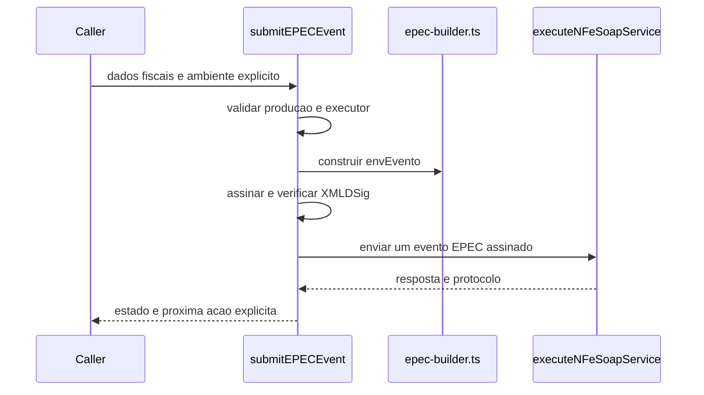

# submit-epec-event.ts

## Visao geral

Submete um evento EPEC pelo servico SOAP apropriado e retorna a classificacao operacional do evento.

## Responsabilidades

- Validar os dados de producao antes de qualquer chamada externa.
- Construir o envelope EPEC e rotear pelo destino SVC definido para a UF.
- Assinar o evento com o `SigningContext` fornecido e verificar a assinatura localmente antes do transporte.
- Exigir protocolo de 15 digitos para registrar um evento em producao.
- Retornar a chave, protocolo, acao de recovery e limite paulista de reconciliacao.

## Entradas e saidas

- Entrada: `EPECEventInput`.
- Saida: `Promise<EPECEventOutcome>`.

## Fluxo principal



## Tratamento de erros e casos-limite

- Dados invalidos e ausencia de executor mTLS em producao retornam `usage-error` sem transporte.
- Contexto de assinatura invalido impede a transmissao; eventos usam os algoritmos XMLDSig definidos pelo schema oficial.
- Protocolo ausente ou invalido impede `registered`.
- Evento aceito retorna `awaiting-recovery`, `transmitNFeAfterRecovery` e `reconciliationDeadlineDays: 7`.
- O SDK nao envia a NF-e junto com o evento, nao inicia polling e nao persiste o registro.

## Exemplos

```ts
const result = await submitEPECEvent({ ...productionEPECInput });
if (result.nextAction === 'transmitNFeAfterRecovery') {
  // Persist caller-owned correlation and submit the matching NF-e explicitly later.
}
```

## Dependencias e integracoes

- `./epec/contracts.ts`
- `./epec/epec-builder.ts`
- `./epec/epec-svc-routing.ts`
- `../transport/execute-nfe-soap-service.ts`