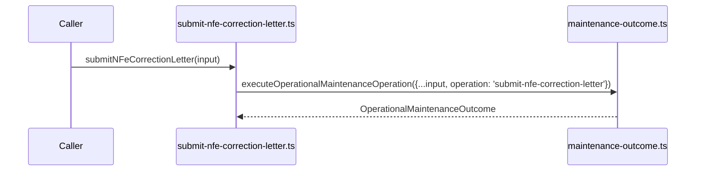

# src/canonical/nfe/submit-nfe-correction-letter.ts

## Visao geral

Expõe a operacao interna da carta de correcao homologada com a mesma taxonomia operacional do restante do MVP.

## Responsabilidades

- Fixar o identificador `submit-nfe-correction-letter`.
- Delegar a execucao para a orquestracao compartilhada de manutencao.
- Preservar a fronteira entre operacao publica e montagem interna do payload.

## Entradas e saidas

- Entradas: `OperationalMaintenanceFacadeInput`.
- Saidas: `Promise<OperationalMaintenanceOutcome>`.

## Fluxo principal



## Tratamento de erros e casos-limite

- A boundary de ambiente fora de escopo continua estruturada no modulo compartilhado.

## Exemplos

```ts
import { submitNFeCorrectionLetter } from './submit-nfe-correction-letter.js';
```

## Dependencias e integracoes

- `./maintenance-outcome.js`
- `./contracts.js`
