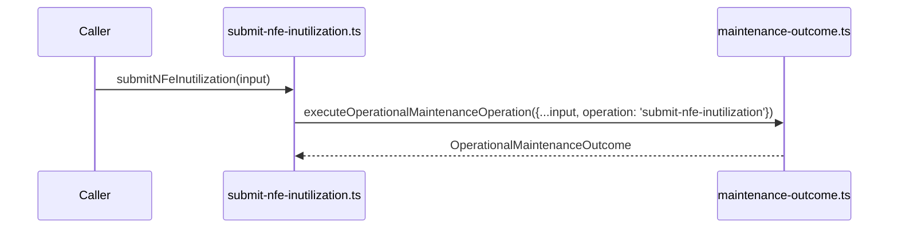

# src/canonical/nfe/submit-nfe-inutilization.ts

## Visao geral

Expõe a operacao interna de inutilizacao homologada a partir da orquestracao compartilhada de manutencao.

## Responsabilidades

- Fixar o identificador `submit-nfe-inutilization`.
- Delegar a execucao para o modulo compartilhado de manutencao.
- Preservar a interface especifica da operacao sem duplicar logica de transporte.

## Entradas e saidas

- Entradas: `OperationalMaintenanceFacadeInput`.
- Saidas: `Promise<OperationalMaintenanceOutcome>`.

## Fluxo principal



## Tratamento de erros e casos-limite

- A classificacao final depende do mapeamento compartilhado aplicado ao retorno SOAP.

## Exemplos

```ts
import { submitNFeInutilization } from './submit-nfe-inutilization.js';
```

## Dependencias e integracoes

- `./maintenance-outcome.js`
- `./contracts.js`
