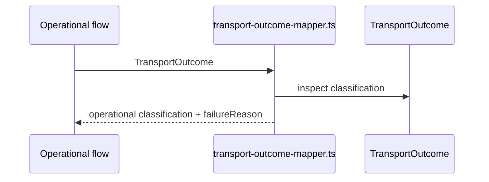

# src/canonical/nfe/transport-outcome-mapper.ts

## Visao geral

Traduz as classificacoes da camada de transporte para a linguagem operacional usada por autorizacao, consultas e manutencoes.

## Responsabilidades

- Reaproveitar `TransportOutcome` como evidencia subjacente.
- Mapear classificacoes de transporte para classificacoes operacionais.
- Sintetizar `failureReason` sem duplicar a taxonomia do transporte.

## Entradas e saidas

- Entradas: `TransportOutcome`.
- Saidas: `OperationalTransportProjection` por contexto operacional.

## Fluxo principal



## Tratamento de erros e casos-limite

- `success` nao gera `failureReason`.
- As outras classificacoes preferem `failureReason` do transporte e usam a mensagem aplicacional como fallback.

## Exemplos

```ts
import { mapTransportOutcomeToQueryClassification } from './transport-outcome-mapper.js';
```

## Dependencias e integracoes

- `./contracts.js`
- `../transport/contracts.js`