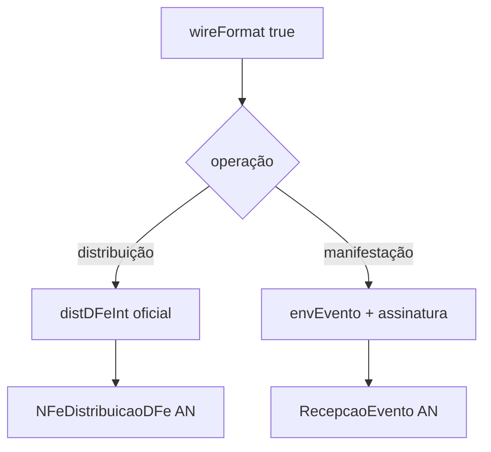

# recipient-wire

## Visão geral

Distribuição DF-e e manifestação do destinatário no formato oficial, inclusive em produção (Ambiente Nacional): `distributeRecipientDFe({ wireFormat: true, authorUF })` e `manifestRecipientOperation({ wireFormat: true, eventDateTime })`.

## Responsabilidades

- Distribuição: `distDFeInt` real com `tpAmb` e `cUFAutor` informados, no envelope `nfeDistDFeInteresse/nfeDadosMsg` do WSDL `NFeDistribuicaoDFe`, com a janela `nextAllowedAt` do resultado.
- Manifestação: `envEvento` completo (namespace, `tpAmb`, `dhEvento`, `cOrgao` 91) assinado com o certificado do destinatário e enviado ao `RecepcaoEvento` nacional; `210240` exige justificativa.
- Recusar antes de enviar: ambiente, ator, NSU, `authorUF`, `eventDateTime` e produção sem `requestExecutor` (`usage-error`).

## Entradas e saídas

Entradas: os requests existentes mais `wireFormat`, `authorUF` (distribuição) e `eventDateTime` (manifestação). Saídas: `RecipientDistributionOutcome` e `RecipientManifestationOutcome`.

## Fluxo principal



## Tratamento de erros e casos-limite

Sem `wireFormat`, produção continua `unsupported-scope` e o comportamento de homologação não muda. `656` segue `usage-error` com bloqueio de 1 hora.

## Exemplos

```ts
await distributeRecipientDFe({ actor, authorUF: '35', environment: 'production', requestExecutor, ultNSU, wireFormat: true });
```

## Dependências e integrações

`buildDistDFeIntXml`, `signEventXml`, `executeNFeSoapService` (`wireFormat`) e os mapeadores de resultado existentes.
