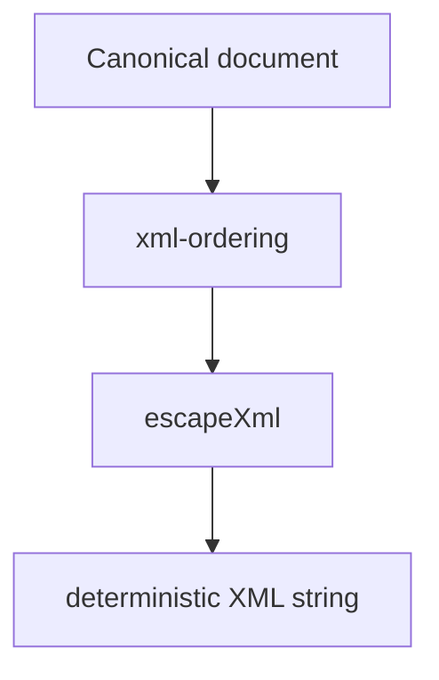

# src/canonical/serialization/deterministic-xml.ts

## Visao geral

Serializa documentos canonicos em XML deterministico para a primeira slice funcional do SDK.

## Responsabilidades

- Emitir `NFe` em XML deterministico.
- Emitir `enviNFe` em XML deterministico.
- Escapar valores XML e reaproveitar a ordem definida em `xml-ordering.ts`.

## Entradas e saidas

- Entradas: `CanonicalNFeDocument` e `CanonicalEnviNFeDocument`.
- Saidas: strings XML deterministicas.

## API / Assinatura

```ts
export function serializeDeterministicNFeXml(document: CanonicalNFeDocument): string;
export function serializeDeterministicEnviNFeXml(
  document: CanonicalEnviNFeDocument,
): string;
```

## Fluxo principal



## Tratamento de erros e casos-limite

- Escapa caracteres especiais para evitar XML invalido.
- Emite payload somente quando houver entradas livres.
- Reutiliza a mesma serializacao de `NFe` dentro de `enviNFe`.

## Exemplos

```ts
const xml = serializeDeterministicNFeXml(document);
```

## Dependencias e integracoes

- `./xml-ordering`
- `../shared/contracts`