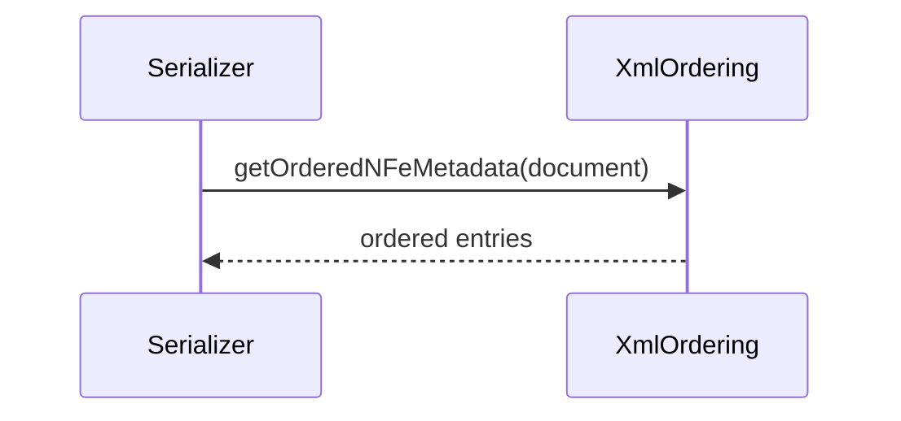

# src/canonical/serialization/xml-ordering.ts

## Visao geral

Define a ordem deterministica dos metadados e payloads emitidos pelos serializers canonicos.

## Responsabilidades

- Fixar a ordem de tags para `NFe`.
- Fixar a ordem de tags para `enviNFe`.
- Ordenar chaves livres de payload alfabeticamente.

## Entradas e saidas

- Entradas: documentos canonicos ou payloads livres.
- Saidas: listas ordenadas de pares `tag`/`value`.

## API / Assinatura

```ts
export function getOrderedNFeMetadata(
  document: CanonicalNFeDocument,
): ReadonlyArray<readonly [string, string]>;
```

## Fluxo principal



## Tratamento de erros e casos-limite

- Payload vazio retorna uma lista vazia.
- A ordem e fixa para evitar drift entre execucoes.

## Exemplos

```ts
const entries = getOrderedPayloadEntries({ b: '2', a: '1' });
```

## Dependencias e integracoes

- `./deterministic-xml`
- `../shared/contracts`