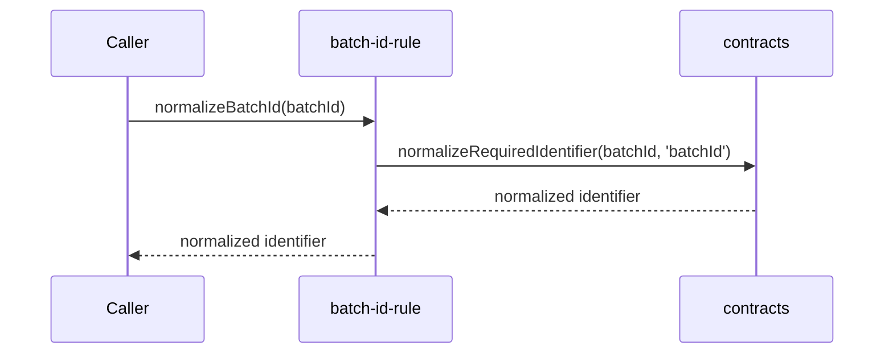

# src/canonical/shared/batch-id-rule.ts

## Visao geral

Normaliza o identificador inicial de lote da camada canonica.

## Responsabilidades

- Validar obrigatoriedade de `batchId`.
- Reaproveitar a normalizacao base de identificadores.

## Entradas e saidas

- Entradas: string `batchId`.
- Saidas: `batchId` normalizado.

## Fluxo principal



## Tratamento de erros e casos-limite

- Lanca erro quando o identificador chega vazio.

## Exemplos

```ts
const batchId = normalizeBatchId('  0001  ');
```

## Dependencias e integracoes

- `./contracts`