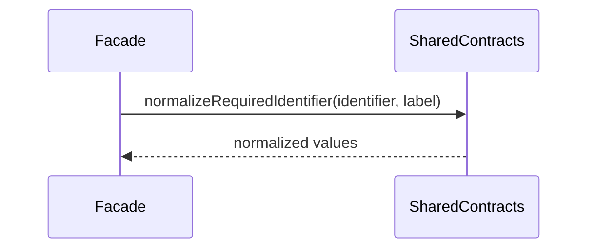

# src/canonical/shared/contracts.ts

## Visao geral

Define os contratos publicos e as regras basicas de normalizacao da camada canonica inicial.

## Responsabilidades

- Declarar entradas e saidas canonicas de `NFe` e `enviNFe`.
- Registrar a familia de schema usada como proveniencia.
- Declarar o tipo de gap funcional rastreado pela facade.
- Permitir gaps para superficies operacionais explicitamente deferidas.
- Fornecer a normalizacao base de identificadores obrigatorios.

## Entradas e saidas

- Entradas: valores crus recebidos da facade publica.
- Saidas: tipos canonicos e valores normalizados usados pelos criadores de documento.

## API / Assinatura

```ts
export function normalizeRequiredIdentifier(identifier: string, label: string): string;
```

## Fluxo principal



## Tratamento de erros e casos-limite

- Lanca erro quando identificadores obrigatorios chegam vazios.

## Exemplos

```ts
const documentId = normalizeRequiredIdentifier('NFe001', 'documentId');
```

## Dependencias e integracoes

- Consumido por `../nfe/canonical-nfe.ts`
- Consumido por `../nfe/canonical-envi-nfe.ts`
- Complementado por `./environment-rule.ts`, `./version-rule.ts`, `./document-id-rule.ts` e `./batch-id-rule.ts`