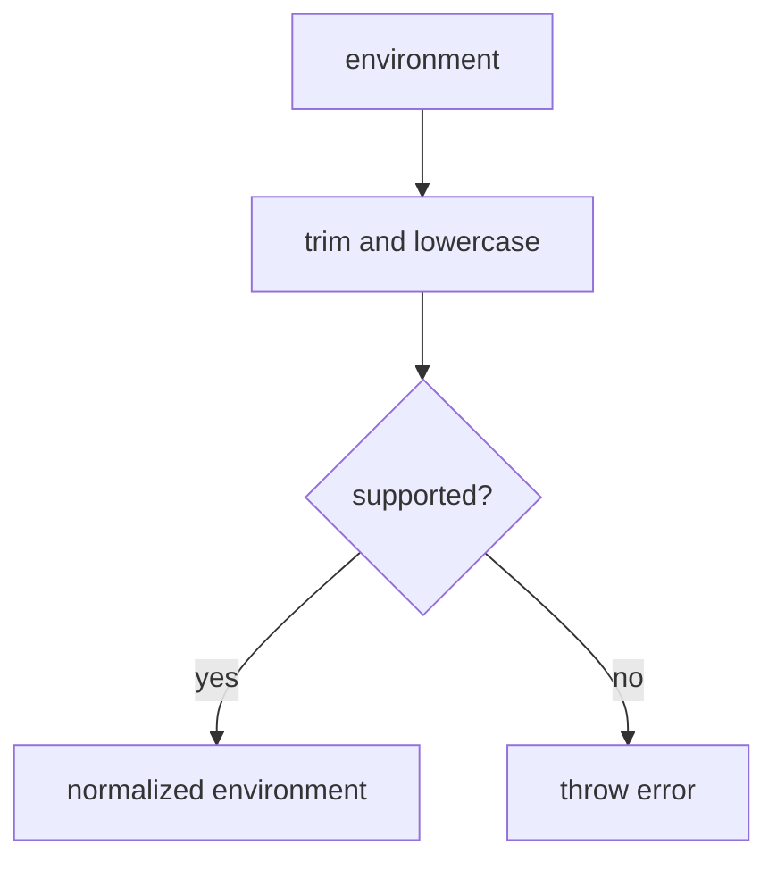

# src/canonical/shared/environment-rule.ts

## Visao geral

Normaliza o ambiente suportado pela facade canonica inicial.

## Responsabilidades

- Aceitar apenas `homologation` e `production`.
- Remover espacos e padronizar o valor.

## Entradas e saidas

- Entradas: string de ambiente.
- Saidas: `CanonicalEnvironment`.

## Fluxo principal



## Tratamento de erros e casos-limite

- Lanca erro para valores nao suportados.

## Exemplos

```ts
const environment = normalizeEnvironment(' homologation ');
```

## Dependencias e integracoes

- `./contracts`