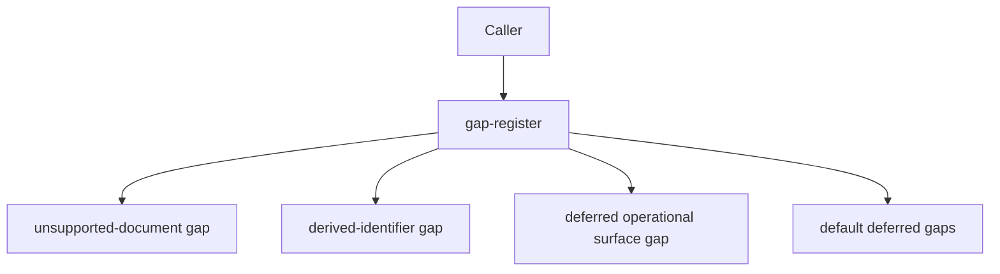

# src/canonical/shared/gap-register.ts

## Visao geral

Centraliza o registro das lacunas explicitamente adiadas pela facade canonica inicial.

## Responsabilidades

- Criar gaps para documentos fora do escopo.
- Criar gaps para identificadores derivados adiados.
- Criar gaps para superficies operacionais explicitamente deferidas.
- Listar as lacunas padrao da primeira slice funcional.

## Entradas e saidas

- Entradas: nomes de documentos ou identificadores.
- Saidas: `FunctionalCoverageGap` ou colecoes de gaps.

## API / Assinatura

```ts
export function createUnsupportedDocumentGap(documentName: string): FunctionalCoverageGap;
export function createDerivedIdentifierDeferredGap(identifierName: string): FunctionalCoverageGap;
export function createDeferredOperationalSurfaceGap(surfaceName: string): FunctionalCoverageGap;
export function getInitialCanonicalDeferredGaps(): readonly FunctionalCoverageGap[];
```

## Fluxo principal



## Tratamento de erros e casos-limite

- O modulo nao lanca erro; apenas materializa lacunas estruturadas.

## Exemplos

```ts
const gaps = getInitialCanonicalDeferredGaps();
```

## Dependencias e integracoes

- `./contracts`
- `../nfe/canonical-nfe.ts`
- `../nfe/canonical-envi-nfe.ts`