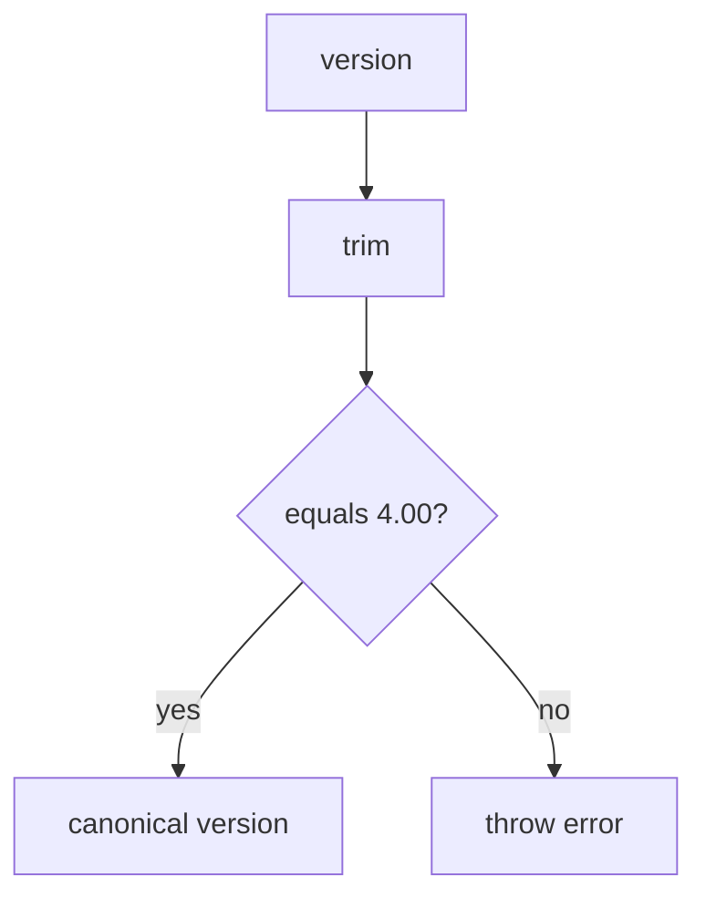

# src/canonical/shared/version-rule.ts

## Visao geral

Normaliza a versao suportada pela facade canonica inicial.

## Responsabilidades

- Aceitar apenas a versao `4.00`.
- Rejeitar variacoes fora do recorte desta fase.

## Entradas e saidas

- Entradas: string de versao.
- Saidas: `CanonicalVersion`.

## Fluxo principal



## Tratamento de erros e casos-limite

- Lanca erro quando a versao nao e `4.00`.

## Exemplos

```ts
const version = normalizeVersion('4.00');
```

## Dependencias e integracoes

- `./contracts`