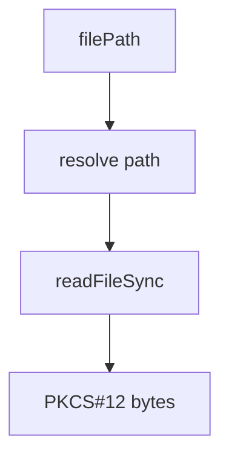

# src/canonical/signing/a1-file-source.ts

## Visao geral

Carrega do filesystem o certificado A1 fornecido por caminho de arquivo.

## Responsabilidades

- Validar `filePath` nao vazio.
- Ler bytes PKCS#12 a partir do caminho resolvido.

## Entradas e saidas

- Entradas: `FilePathSigningSourceInput`.
- Saidas: `Buffer` com bytes PKCS#12.

## Fluxo principal



## Tratamento de erros e casos-limite

- Rejeita caminho vazio.
- Falha claramente quando o arquivo nao puder ser lido.

## Exemplos

```ts
const bytes = loadPkcs12FromFile(source);
```

## Dependencias e integracoes

- `contracts.ts`
- `errors.ts`
- `create-signing-context.ts`