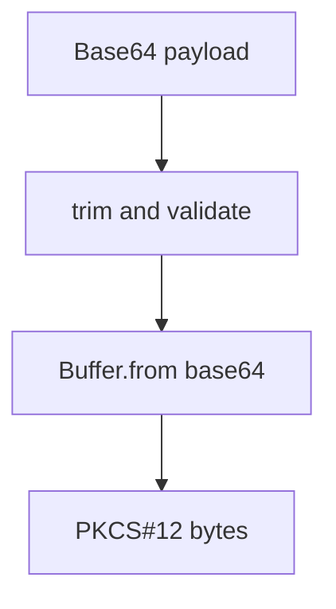

# src/canonical/signing/a1-memory-source.ts

## Visao geral

Converte o certificado A1 fornecido em memoria para bytes PKCS#12 utilizaveis pelo parser.

## Responsabilidades

- Validar payload Base64 nao vazio.
- Decodificar o conteudo em `Buffer`.

## Entradas e saidas

- Entradas: `InMemorySigningSourceInput`.
- Saidas: `Buffer` com bytes PKCS#12.

## Fluxo principal



## Tratamento de erros e casos-limite

- Rejeita string vazia.
- Rejeita payload que nao possa ser parseado pela etapa seguinte de contexto.

## Exemplos

```ts
const bytes = loadPkcs12FromMemory(source);
```

## Dependencias e integracoes

- `contracts.ts`
- `errors.ts`
- `create-signing-context.ts`