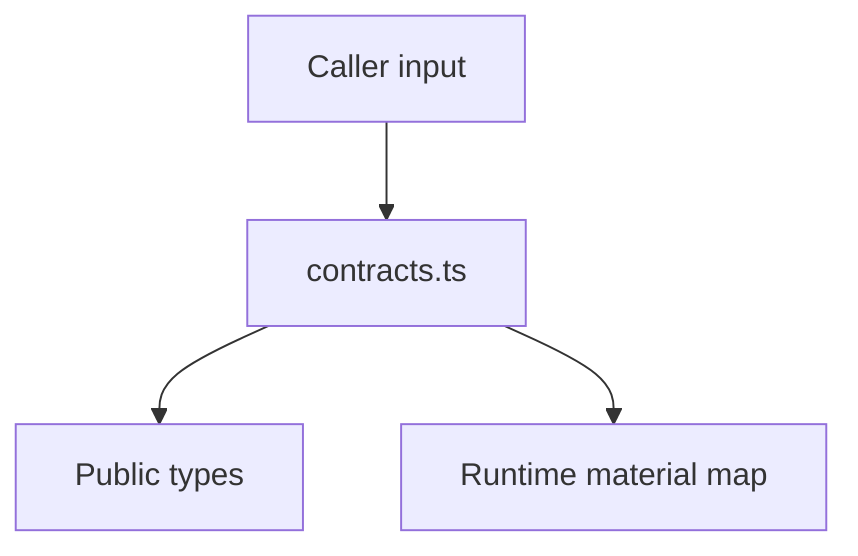

# src/canonical/signing/contracts.ts

## Visao geral

Define o contrato tipado do slice inicial de assinatura digital.

## Responsabilidades

- Modelar as origens aceitas de certificado A1.
- Representar o `SigningContext` publico.
- Manter o vinculo interno entre contexto publico e material criptografico de runtime.

## Entradas e saidas

- Entradas: objetos `CreateSigningContextInput` e `SignNFeXmlInput`.
- Saidas: tipos publicos, constantes de algoritmo e helpers de runtime.

## Fluxo principal



## Tratamento de erros e casos-limite

- O arquivo nao lanca erros diretamente.
- O `WeakMap` evita expor PEMs no objeto publico retornado ao consumidor.

## Exemplos

```ts
type Input = CreateSigningContextInput;
```

## Dependencias e integracoes

- `create-signing-context.ts`
- `sign-nfe-xml.ts`
- `source-normalization.ts`