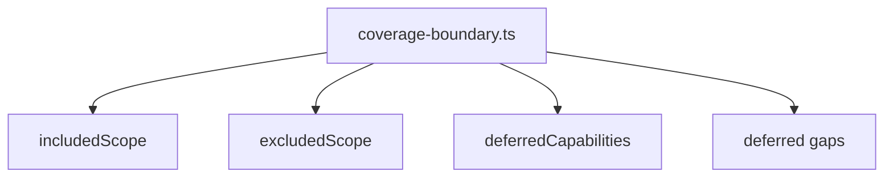

# src/canonical/signing/coverage-boundary.ts

## Visao geral

Materializa os limites formais de cobertura do primeiro slice de assinatura digital.

## Responsabilidades

- Declarar o escopo incluido da feature.
- Declarar escopos explicitamente excluidos.
- Reunir capacidades deferidas e gaps que alimentam documentacao e testes.

## Entradas e saidas

- Entradas: nenhuma.
- Saidas: `SigningCoverageBoundary` e acesso aos gaps deferidos.

## Fluxo principal



## Tratamento de erros e casos-limite

- O modulo e deterministico e nao recebe entrada externa.
- A principal preocupacao e manter a terminologia consistente com spec, plan e quickstart.

## Exemplos

```ts
const boundary = getSigningCoverageBoundary();
```

## Dependencias e integracoes

- `./deferred-signing-gaps.js`
- `tests/unit/signing-coverage-boundary.test.ts`