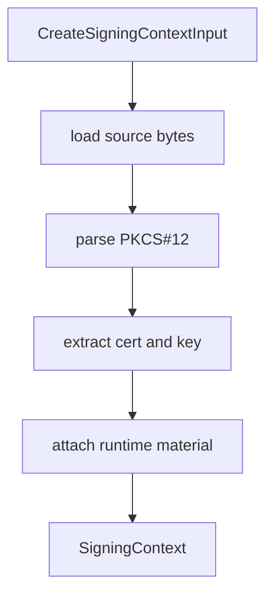

# src/canonical/signing/create-signing-context.ts

## Visao geral

Converte um certificado A1 suportado em um `SigningContext` reutilizavel e seguro para a API publica.

## Responsabilidades

- Carregar bytes PKCS#12 de arquivo ou memoria.
- Extrair certificado e chave privada.
- Montar o `SigningContext` com metadados publicos e armazenar o material sensivel apenas em runtime.

## Entradas e saidas

- Entradas: `CreateSigningContextInput`.
- Saidas: `Promise<SigningContext>`.

## Fluxo principal



## Tratamento de erros e casos-limite

- Rejeita `passphrase` vazia.
- Falha quando o PKCS#12 nao contem certificado e chave privada.
- Normaliza a identidade do certificado para diagnostico e testes.

## Exemplos

```ts
const context = await createSigningContext({ passphrase, source });
```

## Dependencias e integracoes

- `node-forge`
- `./a1-file-source.js`
- `./a1-memory-source.js`
- `./contracts.js`
- `./source-normalization.js`