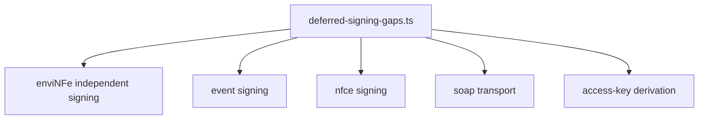

# src/canonical/signing/deferred-signing-gaps.ts

## Visao geral

Lista os gaps explicitamente deferidos para fases futuras do roadmap de assinatura.

## Responsabilidades

- Representar cada gap como conhecimento estavel e testavel.
- Evitar que limites de escopo fiquem apenas em texto livre de planejamento.

## Entradas e saidas

- Entradas: nenhuma.
- Saidas: lista `DeferredSigningGap`.

## Fluxo principal



## Tratamento de erros e casos-limite

- O modulo e deterministico e nao depende de entrada externa.

## Exemplos

```ts
const gaps = getDeferredSigningGaps();
```

## Dependencias e integracoes

- `coverage-boundary.ts`
- `specs/005-add-digital-signing/quickstart.md`