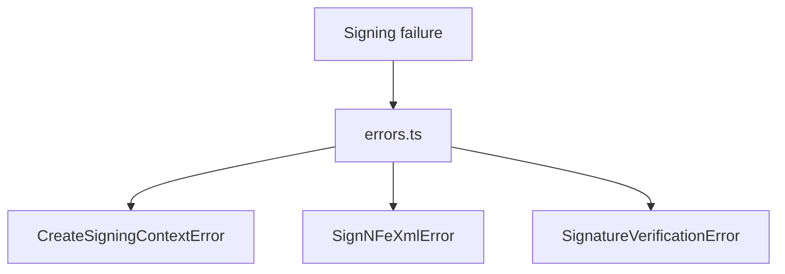

# src/canonical/signing/errors.ts

## Visao geral

Agrupa as classes de erro usadas pelo slice inicial de assinatura digital.

## Responsabilidades

- Definir uma hierarquia simples de erros para contexto, assinatura e verificacao.
- Padronizar mensagens observaveis nos testes e no contrato publico.

## Entradas e saidas

- Entradas: mensagens de erro.
- Saidas: instancias de `SigningError` e subclasses.

## Fluxo principal



## Tratamento de erros e casos-limite

- O modulo nao captura falhas; apenas tipa e nomeia excecoes.

## Exemplos

```ts
throw new SignNFeXmlError('The signed XML did not pass local verification.');
```

## Dependencias e integracoes

- `create-signing-context.ts`
- `sign-nfe-xml.ts`
- `verify-signed-nfe-xml.ts`