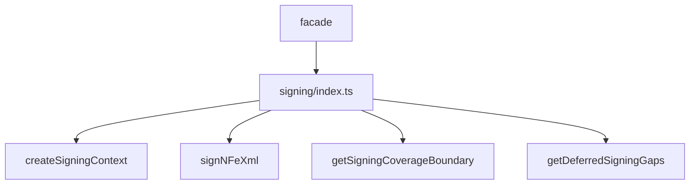

# src/canonical/signing/index.ts

## Visao geral

Barrel interno do slice inicial de assinatura digital da feature 005.

## Responsabilidades

- Reexportar as operacoes principais de assinatura.
- Centralizar os tipos publicos e internos do slice.
- Manter um ponto unico de entrada para modulos vizinhos.

## Entradas e saidas

- Entradas: nenhuma.
- Saidas: funcoes de assinatura, boundary model e tipos associados.

## Fluxo principal



## Tratamento de erros e casos-limite

- O barrel nao implementa regras de negocio.
- Validacoes acontecem nos modulos especializados.

## Exemplos

```ts
import { createSigningContext, signNFeXml } from './index.js';
```

## Dependencias e integracoes

- `./contracts.js`
- `./coverage-boundary.js`
- `./create-signing-context.js`
- `./deferred-signing-gaps.js`
- `./sign-nfe-xml.js`