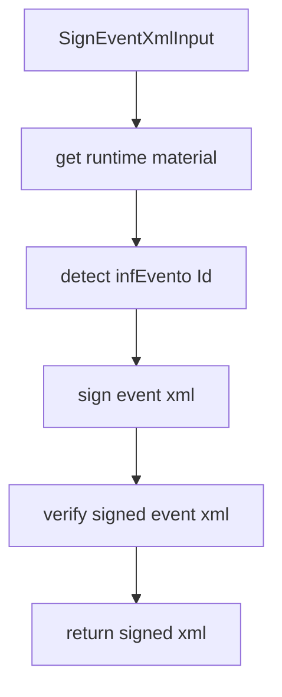

# src/canonical/signing/sign-event-xml.ts

## Visao geral

Orquestra a assinatura XMLDSig de um `evento` suportado e exige verificacao local antes do retorno.

## Responsabilidades

- Recuperar o material criptografico do `SigningContext` reutilizavel.
- Detectar o `Id` assinavel de `infEvento`.
- Assinar o XML, validar a referencia assinada e devolver somente o XML verificado.

## Entradas e saidas

- Entradas: `SignEventXmlInput`.
- Saidas: `Promise<string>` com o XML de evento assinado.

## Fluxo principal



## Tratamento de erros e casos-limite

- Rejeita contextos que nao foram criados por esta instancia do SDK.
- Falha quando o XML nao contem `infEvento` ou quando o atributo `Id` esta ausente.
- Falha quando a referencia verificada nao corresponde ao `Id` esperado.
- Nao devolve XML parcialmente assinado em caso de erro.

## Exemplos

```ts
const signedXml = await signEventXml({ signingContext, unsignedXml });
```

## Dependencias e integracoes

- `./contracts.js`
- `./event-signature-target.js`
- `./verify-signed-event-xml.js`
- `./xml-signature.js`