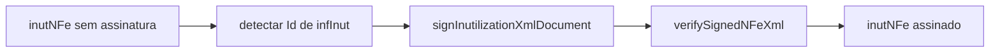

# signInutilizationXml

## Visão geral

Assina o pedido `inutNFe` (referência `infInut`, RSA-SHA1, C14N, assinatura envelopada anexada a `inutNFe`) e confere a assinatura localmente antes de devolver.

## Responsabilidades

Detectar o `Id` de `infInut`, assinar com o material do contexto de assinatura do SDK e verificar a assinatura gerada.

## Entradas e saídas

Entrada: `{ signingContext, unsignedXml }`. Saída: XML assinado. Erros: `SignEventXmlError` para contexto de outra origem, `infInut` sem `Id` ou verificação local inválida.

## Fluxo principal

## Tratamento de erros e casos-limite

A referência assinada deve coincidir com o `Id` detectado; caso contrário a assinatura é recusada.

## Exemplos

Ver `tests/integration/nfe-signed-inutilization.test.ts`.

## Dependências e integrações

`xml-crypto` por meio de `xml-signature.ts` e `verifySignedNFeXml`. Usado por `executeSignedNFeEvent`.
