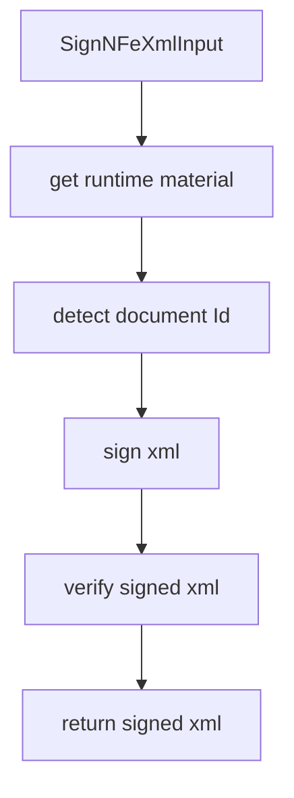

# src/canonical/signing/sign-nfe-xml.ts

## Visao geral

Orquestra a assinatura XMLDSig do XML de `NFe` e exige verificacao local antes do retorno.

## Responsabilidades

- Recuperar o material criptografico do `SigningContext`.
- Detectar o `Id` assinavel de `infNFe`.
- Assinar o XML e validar o resultado localmente.

## Entradas e saidas

- Entradas: `SignNFeXmlInput`.
- Saidas: `Promise<string>` com o XML assinado.

## Fluxo principal



## Tratamento de erros e casos-limite

- Rejeita contextos que nao foram criados por esta instancia do SDK.
- Falha quando a referencia verificada nao corresponde ao `Id` esperado.
- Nao devolve XML parcialmente assinado em caso de erro.

## Exemplos

```ts
const signedXml = await signNFeXml({ signingContext, unsignedXml });
```

## Dependencias e integracoes

- `./contracts.js`
- `./verify-signed-nfe-xml.js`
- `./xml-signature.js`