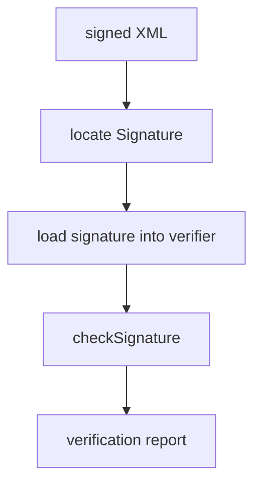

# src/canonical/signing/verify-signed-nfe-xml.ts

## Visao geral

Executa a verificacao local obrigatoria do XML assinado antes do retorno ao caller.

## Responsabilidades

- Localizar o elemento `Signature` no namespace XMLDSig.
- Validar a assinatura com o certificado publico do contexto.
- Devolver a referencia assinada efetivamente validada.

## Entradas e saidas

- Entradas: `signedXml` e `publicCertPem`.
- Saidas: `SignatureVerificationReport`.

## Fluxo principal



## Tratamento de erros e casos-limite

- Falha quando o XML nao contem `Signature`.
- Falha quando a verificacao criptografica nao for valida.

## Exemplos

```ts
const report = verifySignedNFeXml({ publicCertPem, signedXml });
```

## Dependencias e integracoes

- `@xmldom/xmldom`
- `xml-crypto`
- `errors.ts`