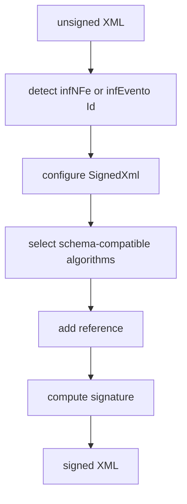

# src/canonical/signing/xml-signature.ts

## Visao geral

Concentra a montagem XMLDSig de XML de `NFe` e `evento`, com algoritmos compativeis com cada familia de schema.

## Responsabilidades

- Localizar `infNFe` ou `infEvento` e usar seu atributo `Id` como referencia.
- Assinar NF-e com SHA-256 e canonicalizacao exclusiva.
- Assinar eventos com RSA-SHA1, digest SHA1 e canonicalizacao XML C14N 1.0 exigidos pelo XSD de XMLDSig.
- Inserir `Signature` no XML assinado.

## Entradas e saidas

- Entradas: XML nao assinado, `documentId`, PEMs de chave e certificado.
- Saidas: XML assinado.

## Fluxo principal



## Tratamento de erros e casos-limite

- Rejeita XML sem `infNFe` ou sem atributo `Id`.
- Mantem algoritmos separados e fixos para NF-e e eventos, conforme seus contratos XSD.

## Exemplos

```ts
const documentId = detectNFeDocumentId(unsignedXml);
```

## Dependencias e integracoes

- `@xmldom/xmldom`
- `xml-crypto`
- `errors.ts`