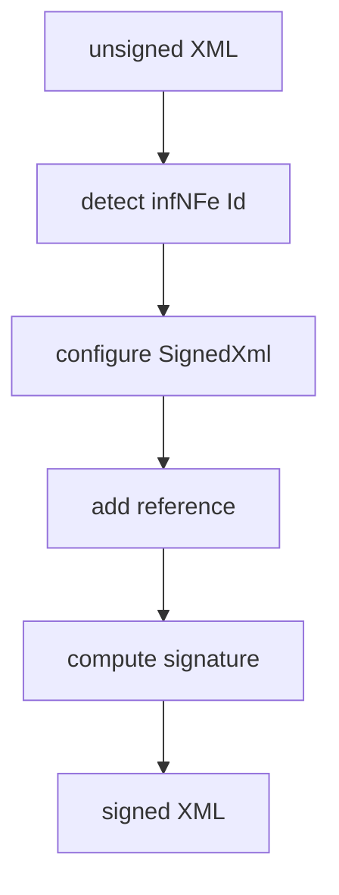

# src/canonical/signing/xml-signature.ts

## Visao geral

Concentra a montagem XMLDSig do XML de `NFe` e a deteccao do `Id` assinavel.

## Responsabilidades

- Localizar `infNFe` e extrair seu atributo `Id`.
- Configurar `xml-crypto` com SHA-256, XMLDSig enveloped e canonicalizacao exclusiva.
- Inserir `Signature` no XML assinado.

## Entradas e saidas

- Entradas: XML nao assinado, `documentId`, PEMs de chave e certificado.
- Saidas: XML assinado.

## Fluxo principal



## Tratamento de erros e casos-limite

- Rejeita XML sem `infNFe` ou sem atributo `Id`.
- Mantem os algoritmos explicitamente fixos para previsibilidade da regressao.

## Exemplos

```ts
const documentId = detectNFeDocumentId(unsignedXml);
```

## Dependencias e integracoes

- `@xmldom/xmldom`
- `xml-crypto`
- `errors.ts`