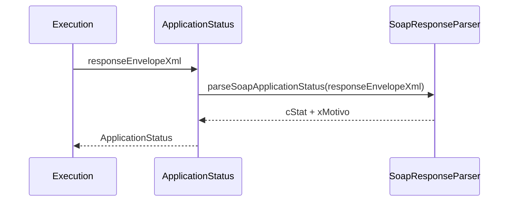

# src/canonical/transport/application-status.ts

## Visao geral

Consolida a extracao do status aplicacional minimo a partir de respostas SOAP.

## Responsabilidades

- Delegar o parsing do envelope SOAP.
- Publicar um shape pequeno e estavel para o restante da classificacao.

## Entradas e saidas

- Entradas: `responseEnvelopeXml`.
- Saidas: `ApplicationStatus`.

## API / Assinatura

```ts
export function extractApplicationStatus(
  responseEnvelopeXml: string,
): ApplicationStatus;
```

## Fluxo principal



## Tratamento de erros e casos-limite

- Campos ausentes retornam como `undefined`.
- O arquivo nao valida o schema completo da resposta.

## Exemplos

```ts
const status = extractApplicationStatus('<cStat>107</cStat>');
```

## Dependencias e integracoes

- `soap-response-parser.ts`
- `execute-nfe-soap-service.ts`
- `transport-outcome-classification.ts`