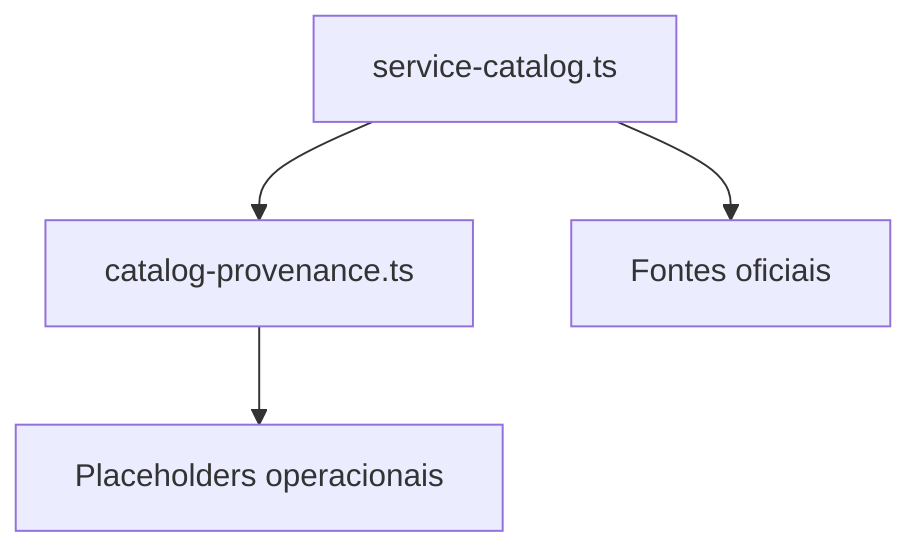

# src/canonical/transport/catalog-provenance.ts

## Visao geral

Concentra a proveniencia normativa do catalogo de transporte e os placeholders internos que ainda sobrarem para expansoes futuras.

## Responsabilidades

- Evitar duplicacao de fontes do catalogo compartilhado.
- Registrar placeholders residuais apenas quando alguma operacao ainda nao estiver publicada.
- Fornecer notas de proveniencia reutilizaveis para o catalogo e para os testes.

## Entradas e saidas

- Entradas: nenhuma.
- Saidas: fontes oficiais e placeholders internos de servico.

## Fluxo principal



## Tratamento de erros e casos-limite

- O modulo nao faz IO nem resolve endpoints.
- Quando todos os servicos planejados de uma fase ja estao publicados, a lista de placeholders pode ficar vazia sem alterar a proveniencia das entradas reais.

## Exemplos

```ts
import { getOperationalTransportCatalogPlaceholders } from './catalog-provenance.js';
```

## Dependencias e integracoes

- `service-catalog.ts`
- `supported-services.ts`
- `specs/006-add-soap-transport/research.md`
- `specs/007-nfe-operational-mvp/research.md`