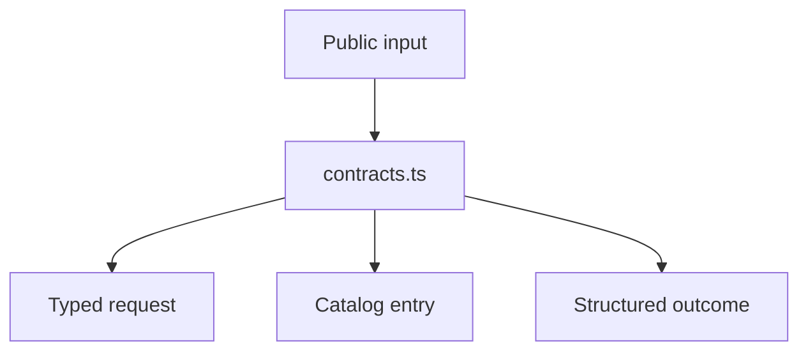

# src/canonical/transport/contracts.ts

## Visao geral

Define os tipos publicos e internos compartilhados pelo slice inicial de transporte SOAP.

## Responsabilidades

- Declarar entradas publicas de resolucao e execucao, incluindo selecao opcional de authorizer.
- Representar catalogo, evidencias e resultado estruturado.
- Centralizar os tipos do ambiente e das classificacoes de resultado.

## Entradas e saidas

- Entradas: `ResolveNFeServiceEndpointInput` e `ExecuteNFeSoapServiceInput`.
- Saidas: `ServiceCatalogEntry`, `TransportRequest`, `SoapExchangeEvidence` e `TransportOutcome`.

## API / Assinatura

```ts
export function getSupportedTransportEnvironments(): readonly TransportEnvironment[];
export function getTransportOutcomeClassifications(): readonly TransportOutcomeClassification[];
```

## Fluxo principal



## Tratamento de erros e casos-limite

- O arquivo nao lanca erros diretamente.
- Ambientes e classificacoes suportados ficam restritos aos valores publicados pelo slice.
- `authorizer` e opcional para manter compatibilidade com rotas unicas; deve ser informado quando a combinacao de servico e ambiente possuir mais de uma rota.

## Exemplos

```ts
const environments = getSupportedTransportEnvironments();
```

## Dependencias e integracoes

- `request-executor.ts`
- `service-catalog.ts`
- `resolve-nfe-service-endpoint.ts`
- `execute-nfe-soap-service.ts`