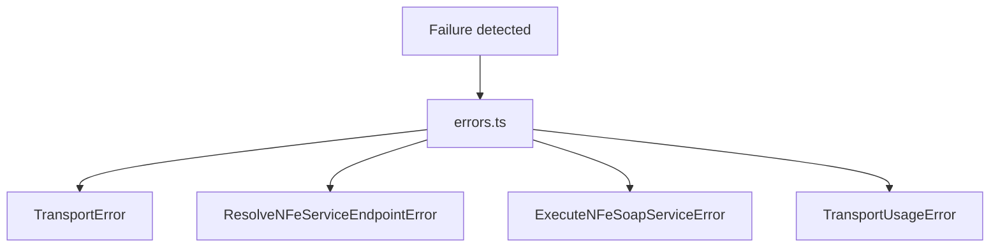

# src/canonical/transport/errors.ts

## Visao geral

Consolida a hierarquia de erros do slice inicial de transporte SOAP.

## Responsabilidades

- Definir o erro base do slice.
- Diferenciar falhas de resolucao, execucao e uso indevido.
- Oferecer nomes de erro estaveis para contratos e testes.

## Entradas e saidas

- Entradas: mensagens de erro.
- Saidas: instancias de `TransportError` e subclasses.

## Fluxo principal



## Tratamento de erros e casos-limite

- Cada erro recebe `name` explicito para facilitar asserts e logs.
- O arquivo nao agrega contexto de runtime por conta propria.
- A mensagem para combinacao nao suportada e centralizada para manter o diagnostico estavel.

## Exemplos

```ts
throw new TransportUsageError('payloadXml is required.');
```

## Dependencias e integracoes

- `resolve-nfe-service-endpoint.ts`
- `execute-nfe-soap-service.ts`
- testes de unidade e integracao do slice de transporte