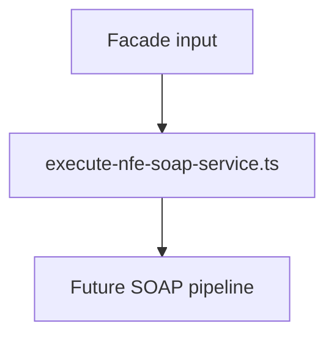

# src/canonical/transport/execute-nfe-soap-service.ts

## Visao geral

Define o ponto de execucao do slice inicial de transporte SOAP.

## Responsabilidades

- Resolver o endpoint suportado pelo ambiente, servico e authorizer opcional.
- Montar o envelope SOAP 1.2 para o payload informado.
- Executar a chamada via executor injetado ou default.
- Classificar o retorno inicial em sucesso, timeout, erro de uso, indisponibilidade, rejeicao funcional ou erro protocolar.

## Entradas e saidas

- Entradas: `ExecuteNFeSoapServiceInput`.
- Saidas: `Promise<TransportOutcome>`.

## API / Assinatura

```ts
export async function executeNFeSoapService(
  input: ExecuteNFeSoapServiceInput,
): Promise<TransportOutcome>;
```

## Fluxo principal



## Tratamento de erros e casos-limite

- Retorna `usage-error` quando `payloadXml` vem vazio.
- Retorna `timeout` quando o executor aborta a tentativa.
- Retorna `protocol-error` quando a resposta SOAP nao expõe `cStat` confiavel.
- Encaminha o authorizer ao resolvedor; chamadas sem authorizer continuam validas quando a rota e unica.
- Redige valores de credenciais, certificados e chaves privadas nos envelopes de request/response retornados como evidencia, sem alterar a resposta usada para classificacao nem os metadados de transporte.
- Converte falhas inesperadas em `ExecuteNFeSoapServiceError`.

## Exemplos

```ts
await executeNFeSoapService({
  environment: 'homologation',
  payloadXml: '<xml />',
  service: 'nfe-status-service',
});
```

## Dependencias e integracoes

- `contracts.ts`
- `errors.ts`
- `fetch-request-executor.ts`
- `application-status.ts`
- `resolve-nfe-service-endpoint.ts`
- `soap-envelope.ts`
- `transport-outcome-classification.ts`
- `../facade/execute-nfe-soap-service.ts`