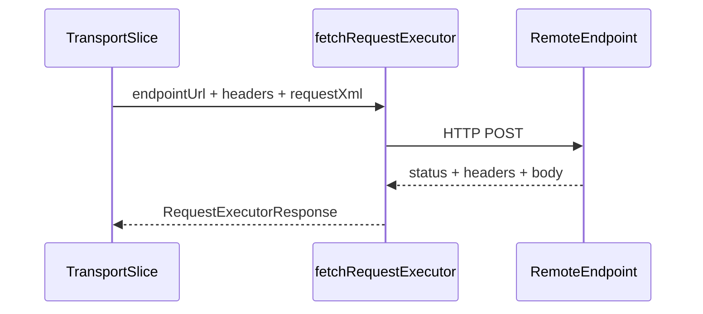

# src/canonical/transport/fetch-request-executor.ts

## Visao geral

Implementa o executor HTTP padrao do slice inicial de transporte usando `fetch` do Node.js.

## Responsabilidades

- Emitir a requisicao POST para o endpoint resolvido.
- Encerrar a tentativa quando o timeout expira.
- Converter headers da resposta para um shape simples do SDK.

## Entradas e saidas

- Entradas: `RequestExecutorInput`.
- Saidas: `RequestExecutorResponse`.

## API / Assinatura

```ts
export const fetchRequestExecutor: RequestExecutor;
```

## Fluxo principal



## Tratamento de erros e casos-limite

- O `AbortController` encerra a chamada quando o timeout estoura.
- O arquivo nao gerencia mTLS nem dispatchers especializados.

## Exemplos

```ts
const response = await fetchRequestExecutor({
  endpointUrl: 'https://example.invalid',
  headers: { 'content-type': 'application/soap+xml; charset=utf-8' },
  requestXml: '<soap:Envelope />',
  service: 'nfe-status-service',
  timeoutMs: 5000,
});
```

## Dependencias e integracoes

- `request-executor.ts`
- `execute-nfe-soap-service.ts`