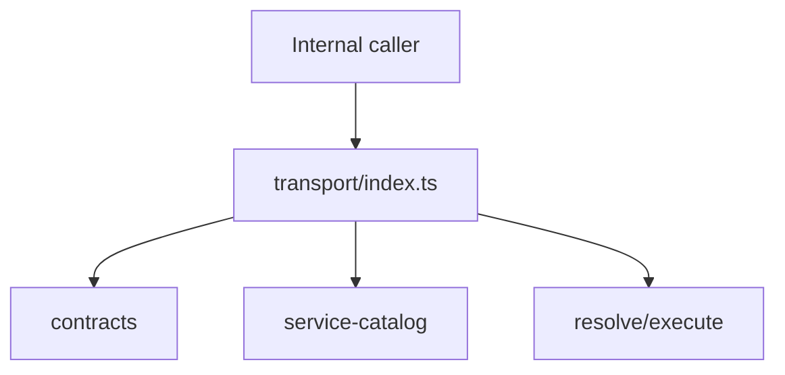

# src/canonical/transport/index.ts

## Visao geral

Agrega o barrel interno do slice de transporte SOAP.

## Responsabilidades

- Reexportar contratos, erros e utilitarios compartilhados do transporte.
- Expor os pontos internos de resolucao e execucao.
- Servir como fronteira unica para imports internos do slice.

## Entradas e saidas

- Entradas: nenhuma.
- Saidas: exports internos tipados e funcoes centrais do transporte.

## Fluxo principal



## Tratamento de erros e casos-limite

- O arquivo nao cria erros diretamente.
- Apenas agrega os modulos internos do slice.

## Exemplos

```ts
export { resolveNFeServiceEndpoint } from './index.js';
```

## Dependencias e integracoes

- `contracts.ts`
- `errors.ts`
- `request-executor.ts`
- `service-catalog.ts`
- `supported-services.ts`