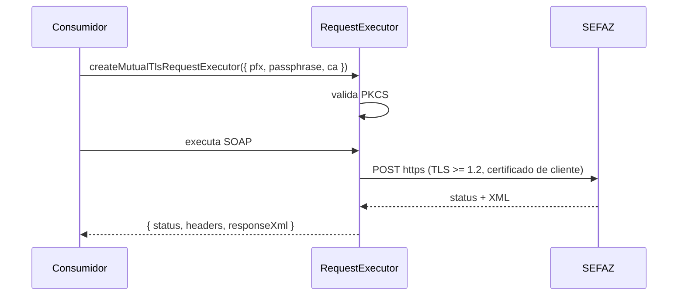

# createMutualTlsRequestExecutor

## Visão geral

Cria um `RequestExecutor` que apresenta o certificado A1 do emitente por TLS mútuo (TLS 1.2 ou superior) ao chamar os web services da SEFAZ. É o executor de produção do servidor consumidor; testes usam executores injetados.

## Responsabilidades

- Validar o PKCS#12 e a senha na criação (falha antes de qualquer chamada de rede).
- Enviar o SOAP por `POST` HTTPS com o certificado de cliente.
- Aplicar o menor entre o timeout da entrada e o `timeoutMs` configurado.
- Não registrar, gravar nem devolver certificado, senha ou envelope em respostas ou erros.

## Entradas e saídas

```ts
interface MutualTlsRequestExecutorOptions {
  pfx: Buffer; // PKCS#12 em memória
  passphrase: string; // senha em memória
  ca?: string | Buffer | ReadonlyArray<string | Buffer>; // raízes adicionais (ICP-Brasil)
  timeoutMs?: number; // limite superior por requisição
}
function createMutualTlsRequestExecutor(options): RequestExecutor;
```

Saída de cada chamada: `{ status, headers, responseXml }`.

## Fluxo principal



## Tratamento de erros e casos-limite

- Excesso de tempo: rejeita com `AbortError`, classificado como `timeout` pela camada SOAP.
- Falha de handshake, certificado de servidor não confiável ou conexão recusada: `TransportError` com apenas o código de rede (classificado como indisponível).
- Endpoint que não seja `https:` é recusado.
- As cadeias da SEFAZ (ICP-Brasil) costumam não estar no repositório padrão do Node.js; informe-as em `ca`.

## Exemplos

```ts
import { authorizeNFe, createMutualTlsRequestExecutor } from '@linkiez/nfe-sdk';

const requestExecutor = createMutualTlsRequestExecutor({
  pfx,
  passphrase,
  ca: icpBrasilRoots,
  timeoutMs: 30_000,
});
```

## Dependências e integrações

`node:https`, `node:tls`, `TransportError` e o contrato `RequestExecutor` ([request-executor.doc.md](request-executor.doc.md)). Cobertura em `tests/integration/mutual-tls-request-executor.test.ts` com servidor HTTPS local e certificados sintéticos.
