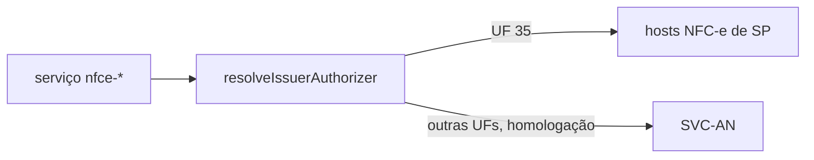

# nfce-lifecycle-catalog-entries

## Visão geral

Entradas do catálogo de transporte dos serviços de ciclo de vida da NFC-e (modelo 65): `nfce-status-service`, `nfce-document-situation`, `nfce-event` (cancelamento e cancelamento por substituição) e `nfce-inutilization`.

## Responsabilidades

- SP (provedor `SP`): endereços próprios da NFC-e nos dois ambientes, conforme o portal da SEFAZ/SP (`/ws/NFeStatusServico4.asmx`, `NFeConsultaProtocolo4.asmx`, `NFeRecepcaoEvento4.asmx`, `NFeInutilizacao4.asmx` em `nfce.fazenda.sp.gov.br` e `homologacao.nfce.fazenda.sp.gov.br`), consultado em 2026-11-14.
- Demais UFs em homologação: ambiente nacional (SVC-AN), o mesmo recuo usado pelo piloto de autorização da NFC-e.
- Cada entrada guarda a fonte oficial em `provenance`.

## Entradas e saídas

Constante `NFCE_LIFECYCLE_CATALOG_ENTRIES`, somada ao catálogo em [service-catalog](./service-catalog.doc.md).

## Fluxo principal



## Tratamento de erros e casos-limite

Produção só existe para SP; outra UF em produção falha fechada. A autorização da NFC-e em homologação usa SVC-AN (catálogo das specs 015 e 027), enquanto estas entradas usam os endereços de homologação do próprio SP; a rodada de homologação (T033) precisa confirmar a coerência.

## Exemplos

```ts
resolveNFeServiceEndpoint({ authorizer: 'SP', environment: 'production', service: 'nfce-event' }).endpointUrl;
// https://nfce.fazenda.sp.gov.br/ws/NFeRecepcaoEvento4.asmx
```

## Dependências e integrações

[catalog-provenance](./catalog-provenance.doc.md), [supported-services](./supported-services.doc.md), [soap-envelope](./soap-envelope.doc.md).
