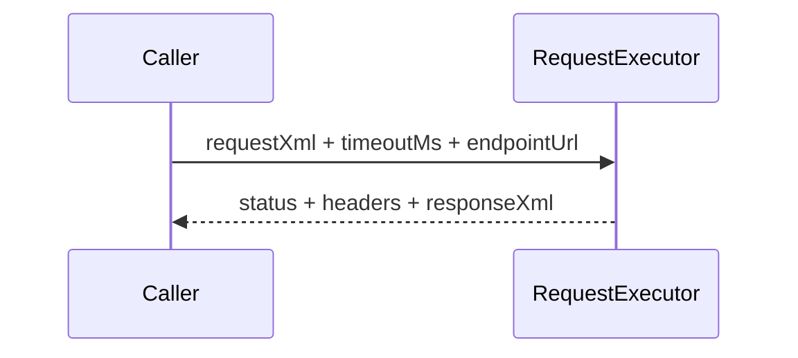

# src/canonical/transport/request-executor.ts

## Visao geral

Define a porta injetavel de execucao HTTP e as regras basicas de timeout do slice inicial de transporte.

## Responsabilidades

- Modelar a entrada e a saida do executor de request.
- Declarar o contrato assincrono usado pela facade publica.
- Fornecer a normalizacao do timeout padrao do slice.

## Entradas e saidas

- Entradas: `RequestExecutorInput` e timeout opcional.
- Saidas: `RequestExecutorResponse` e timeout normalizado.

## API / Assinatura

```ts
export function normalizeTransportTimeout(timeoutMs?: number): number;
```

## Fluxo principal



## Tratamento de erros e casos-limite

- Timeouts nao positivos voltam ao valor padrao.
- O arquivo nao executa rede diretamente.

## Exemplos

```ts
const timeoutMs = normalizeTransportTimeout(undefined);
```

## Dependencias e integracoes

- `contracts.ts`
- `fetch-request-executor.ts`
- `execute-nfe-soap-service.ts`