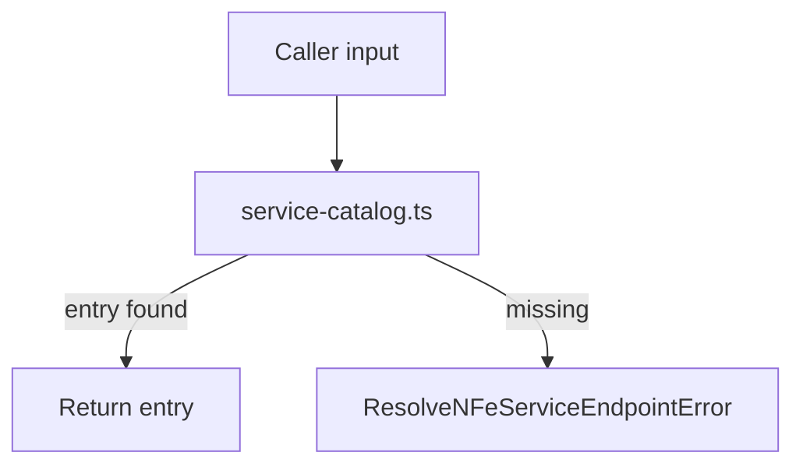

# src/canonical/transport/resolve-nfe-service-endpoint.ts

## Visao geral

Resolve uma entrada unica do catalogo de transporte para uma combinacao de servico e ambiente.

## Responsabilidades

- Consultar o catalogo em memoria.
- Normalizar ambiente e servico antes da busca.
- Garantir que a combinacao esteja dentro da cobertura inicial.
- Traduzir ausencia de entrada em erro contratual claro.

## Entradas e saidas

- Entradas: `ResolveNFeServiceEndpointInput`.
- Saidas: `ServiceCatalogEntry`.

## API / Assinatura

```ts
export function resolveNFeServiceEndpoint(
  input: ResolveNFeServiceEndpointInput,
): ServiceCatalogEntry;
```

## Fluxo principal



## Tratamento de erros e casos-limite

- Lanca erro quando a combinacao nao existe no catalogo atual.
- O diagnostico de erro explicita ambiente e servico solicitados, alem dos limites suportados.
- Nao executa nenhuma operacao de rede.

## Exemplos

```ts
const entry = resolveNFeServiceEndpoint({
  environment: 'homologation',
  service: 'nfe-status-service',
});
```

## Dependencias e integracoes

- `service-catalog.ts`
- `errors.ts`
- `../facade/resolve-nfe-service-endpoint.ts`