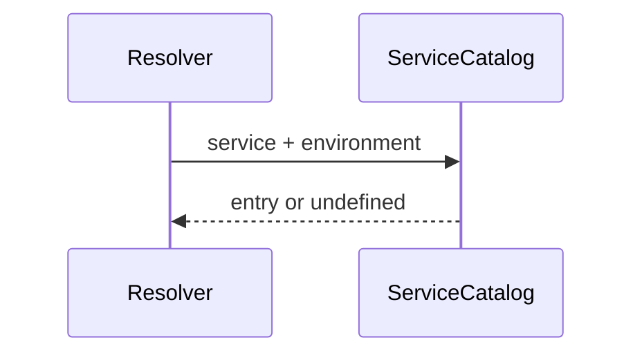

# src/canonical/transport/service-catalog.ts

## Visao geral

Mantem o catalogo versionado em memoria para o slice inicial de transporte SOAP e para o MVP operacional publicado no root import.

## Responsabilidades

- Publicar a versao atual do catalogo.
- Expor a lista de entradas suportadas.
- Fornecer a busca exata por ambiente e servico.
- Reusar a proveniencia oficial sem duplicar fontes nas entradas atuais.
- Preservar a distincao entre entradas publicadas e placeholders ainda inexistentes.

## Entradas e saidas

- Entradas: `ResolveNFeServiceEndpointInput`.
- Saidas: lista de entradas ou uma entrada especifica do catalogo.

## API / Assinatura

```ts
export function findTransportServiceCatalogEntry(
  input: ResolveNFeServiceEndpointInput,
): ServiceCatalogEntry | undefined;

export function getTransportCatalogPlaceholders(): readonly ReturnType<typeof getOperationalTransportCatalogPlaceholders>;
```

## Fluxo principal



## Tratamento de erros e casos-limite

- O arquivo nao lanca erros diretamente.
- Quando a combinacao nao existe no catalogo inicial, a busca retorna `undefined`.
- Os placeholders operacionais nao sao retornados por `findTransportServiceCatalogEntry`.
- O primeiro incremento operacional de consultas adiciona a entrada homologada de `nfe-document-situation` ao catalogo publico.
- O MVP operacional adiciona tambem `nfe-inutilization`, `nfe-cancellation` e `nfe-correction-letter` ao catalogo homologado publicado.
- O slice recipient adiciona as entradas nacionais `nfe-recipient-distribution` e `nfe-recipient-manifestation` ao catalogo publico homologado.
- O slice `015` publica entradas homologada e de producao para `nfce-authorization-pr`, mantendo a proveniencia especifica de `PR` mesmo com reuso do endpoint nacional compartilhado.
- O slice `016` nao publica novo endpoint de contingencia; ele reaproveita o catalogo existente para tornar `SVC-AN` e `SVC-RS` observaveis como diagnostico em `authorizeNFe`.

## Exemplos

```ts
const entries = getTransportServiceCatalog();
```

## Dependencias e integracoes

- `contracts.ts`
- `catalog-provenance.ts`
- `resolve-nfe-service-endpoint.ts`
- `specs/006-add-soap-transport/research.md`