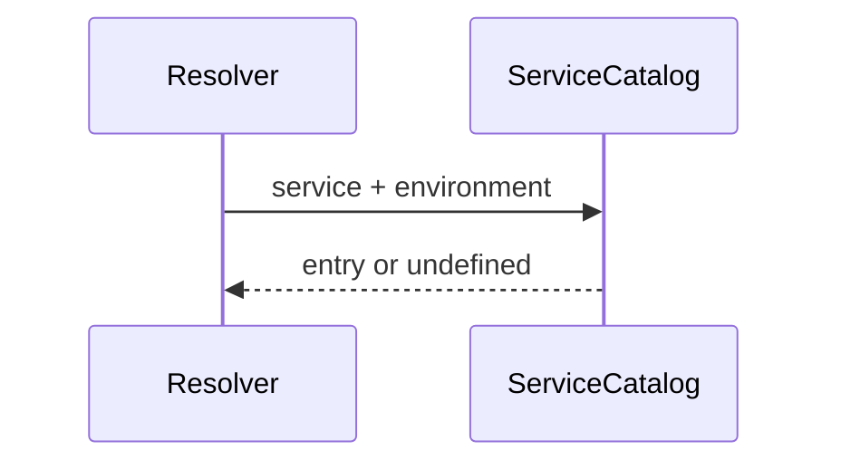

# src/canonical/transport/service-catalog.ts

## Visao geral

Mantem o catalogo versionado em memoria para o slice inicial de transporte SOAP.

## Responsabilidades

- Publicar a versao atual do catalogo.
- Expor a lista de entradas suportadas.
- Fornecer a busca exata por ambiente e servico.

## Entradas e saidas

- Entradas: `ResolveNFeServiceEndpointInput`.
- Saidas: lista de entradas ou uma entrada especifica do catalogo.

## API / Assinatura

```ts
export function findTransportServiceCatalogEntry(
  input: ResolveNFeServiceEndpointInput,
): ServiceCatalogEntry | undefined;
```

## Fluxo principal



## Tratamento de erros e casos-limite

- O arquivo nao lanca erros diretamente.
- Quando a combinacao nao existe no catalogo inicial, a busca retorna `undefined`.

## Exemplos

```ts
const entries = getTransportServiceCatalog();
```

## Dependencias e integracoes

- `contracts.ts`
- `resolve-nfe-service-endpoint.ts`
- `specs/006-add-soap-transport/research.md`