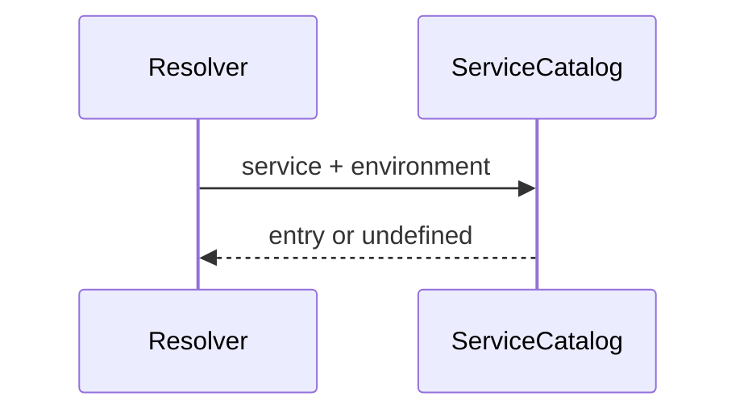

# src/canonical/transport/service-catalog.ts

## Visao geral

Mantem o catalogo versionado em memoria para o slice inicial de transporte SOAP e para o MVP operacional publicado no root import.

## Responsabilidades

- Publicar a versao atual do catalogo.
- Expor a lista de entradas suportadas.
- Fornecer a busca exata por ambiente, servico e authorizer opcional.
- Reusar a proveniencia oficial sem duplicar fontes nas entradas atuais.
- Preservar a distincao entre entradas publicadas e placeholders ainda inexistentes.

## Entradas e saidas

- Entradas: `ResolveNFeServiceEndpointInput`.
- Saidas: lista de entradas ou uma entrada especifica do catalogo.

## API / Assinatura

```ts
export function findTransportServiceCatalogEntry(
  input: ResolveNFeServiceEndpointInput,
): ServiceCatalogEntry | undefined;

export function getTransportCatalogPlaceholders(): readonly ReturnType<typeof getOperationalTransportCatalogPlaceholders>;
```

## Fluxo principal



## Tratamento de erros e casos-limite

- O arquivo nao lanca erros diretamente.
- Quando a combinacao nao existe no catalogo inicial, a busca retorna `undefined`.
- Quando mais de uma entrada corresponde sem authorizer, a busca retorna `undefined` em vez de escolher uma rota arbitrariamente.
- SP production publica `nfe-authorization` e `nfe-authorization-batch` em endpoints normais da SEFAZ/SP; contingencia SVC-AN continua sendo rota distinta.
- SP NFC-e production publica `nfce-authorization-sp` em `https://nfce.fazenda.sp.gov.br/ws/NFeAutorizacao4.asmx`, com provider `SP`; a rota homologada existente e SVC-AN permanecem distintas.
- Os placeholders operacionais nao sao retornados por `findTransportServiceCatalogEntry`.
- O primeiro incremento operacional de consultas adiciona a entrada homologada de `nfe-document-situation` ao catalogo publico.
- O MVP operacional adiciona tambem `nfe-inutilization`, `nfe-cancellation` e `nfe-correction-letter` ao catalogo homologado publicado.
- O slice recipient adiciona as entradas nacionais `nfe-recipient-distribution` e `nfe-recipient-manifestation` ao catalogo publico homologado.
- O slice `015` publica entradas homologada e de producao para `nfce-authorization-pr`, mantendo a proveniencia especifica de `PR` mesmo com reuso do endpoint nacional compartilhado.
- O slice `016` nao publica novo endpoint de contingencia; ele reaproveita o catalogo existente para tornar `SVC-AN` e `SVC-RS` observaveis como diagnostico em `authorizeNFe`.
- A origem da rota NFC-e SP production e registrada em `specs/027-nfce-sp-producao/research.md`.

## Exemplos

```ts
const entries = getTransportServiceCatalog();
```

## Dependencias e integracoes

- `contracts.ts`
- `catalog-provenance.ts`
- `resolve-nfe-service-endpoint.ts`
- `specs/006-add-soap-transport/research.md`
## Rotas oficiais SP e Ambiente Nacional

Além das entradas SVC-AN herdadas, o catálogo contém as rotas publicadas pela SEFAZ/SP em `https://portal.fazenda.sp.gov.br/servicos/nfe/Paginas/URL-WEBSERVICES.aspx` (consultada em 2026-11-10), em homologação e produção, para status, consulta de protocolo, autorização, retorno de autorização, inutilização, cancelamento, carta de correção, eventos genéricos e consulta de cadastro (`provider: 'SP'`), e as rotas do Ambiente Nacional (`provider: 'AN'`) para distribuição DF-e e manifestação do destinatário.

Resolução sem `authorizer`: em produção, mais de um provedor para o mesmo serviço falha fechado (informe o provedor, por exemplo `'SP'` para emitente da UF 35 ou `'SVCAN'` para contingência). Em homologação mantém-se o padrão histórico SVC-AN para quem nunca informou provedor. Serviços exclusivos do AN resolvem sem `authorizer`.

SVAN e SVC-AN foram unificadas pelos avisos oficiais de 25/04/2024 (homologação) e 16/09/2024 (produção, vigente a partir de 11/02/2025) e compartilham os endereços: `https://www.sefazvirtual.fazenda.gov.br/…` em produção e `https://hom.sefazvirtual.fazenda.gov.br/…` em homologação, com o serviço de eventos em `NFeRecepcaoEvento4/NFeRecepcaoEvento4.asmx`. Os hosts `*.svc.fazenda.gov.br` foram descontinuados. As entradas de homologação carregam a versão de catálogo `2026-11-11-svan-svc-an-unified` e citam [o registro dos avisos](../../../docs/_sources/markdown/official/www.nfe.fazenda.gov.br/portal/informe-unificacao-svan-svc-an-2024-2025.md). `nfe-contributor-registration` não faz parte da unificação e mantém seu endereço.
