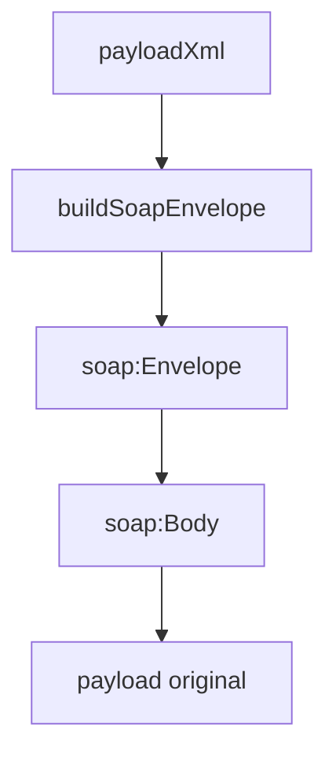

# src/canonical/transport/soap-envelope.ts

## Visao geral

Monta o envelope SOAP 1.2 usado pelo slice inicial de transporte.

## Responsabilidades

- Encapsular o payload XML no `soap:Body`.
- Publicar o namespace SOAP 1.2 esperado pelo slice.
- Manter a montagem do envelope deterministica e pequena.

## Entradas e saidas

- Entradas: servico suportado e `payloadXml`.
- Saidas: string XML do envelope SOAP.

## API / Assinatura

```ts
export function buildSoapEnvelope(
  service: SupportedNFeSoapService,
  payloadXml: string,
): string;
```

## Fluxo principal



## Tratamento de erros e casos-limite

- O payload e apenas normalizado com `trim`.
- Validacoes semanticas do XML permanecem fora deste arquivo.

## Exemplos

```ts
const envelope = buildSoapEnvelope('nfe-status-service', '<consStatServNFe />');
```

## Dependencias e integracoes

- `execute-nfe-soap-service.ts`
- `supported-services.ts`