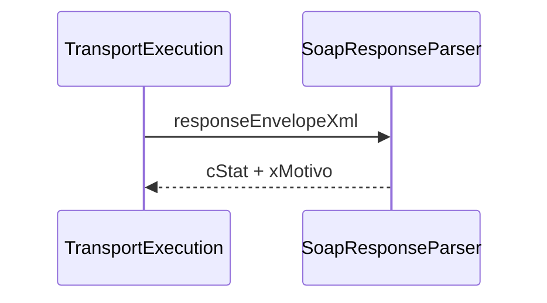

# src/canonical/transport/soap-response-parser.ts

## Visao geral

Extrai o status aplicacional minimo de um envelope SOAP retornado pelo autorizador.

## Responsabilidades

- Localizar `cStat` no XML de resposta.
- Localizar `xMotivo` no XML de resposta.
- Entregar um shape pequeno para classificacao do resultado.

## Entradas e saidas

- Entradas: `responseEnvelopeXml`.
- Saidas: `ParsedSoapApplicationStatus`.

## API / Assinatura

```ts
export function parseSoapApplicationStatus(
  responseEnvelopeXml: string,
): ParsedSoapApplicationStatus;
```

## Fluxo principal



## Tratamento de erros e casos-limite

- Quando uma tag nao existe, o campo correspondente volta como `undefined`.
- O parser inicial nao valida o schema completo da resposta.

## Exemplos

```ts
const parsed = parseSoapApplicationStatus('<cStat>107</cStat>');
```

## Dependencias e integracoes

- `execute-nfe-soap-service.ts`
- testes de integracao do slice de transporte