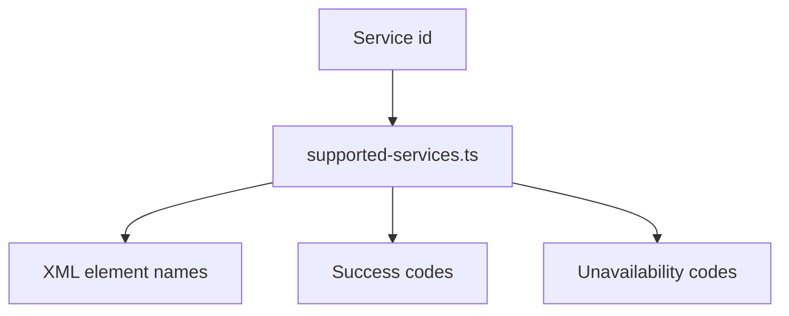

# src/canonical/transport/supported-services.ts

## Visao geral

Define os identificadores de servico SOAP suportados e o metadata estavel usado pelo slice inicial de transporte.

## Responsabilidades

- Declarar os servicos publicados no primeiro slice.
- Associar nomes de elementos XML e codigos de status por servico.
- Centralizar o conhecimento para evitar duplicacao entre envelope, parser e classificacao.

## Entradas e saidas

- Entradas: um identificador `SupportedNFeSoapService`.
- Saidas: definicao estruturada do servico correspondente.

## API / Assinatura

```ts
export function normalizeSupportedTransportService(
  service: string,
): SupportedNFeSoapService | undefined;

export function getSupportedTransportServiceDefinition(
  service: SupportedNFeSoapService,
): SupportedNFeSoapServiceDefinition;
```

## Fluxo principal



## Tratamento de erros e casos-limite

- O arquivo nao lanca erros diretamente.
- Apenas servicos suportados entram nas definicoes exportadas.
- A normalizacao retorna `undefined` quando o servico nao pertence ao slice inicial.

## Exemplos

```ts
const service = getSupportedTransportServiceDefinition('nfe-status-service');
```

## Dependencias e integracoes

- `contracts.ts`
- `service-catalog.ts`
- `soap-envelope.ts`
- `transport-outcome-classification.ts`