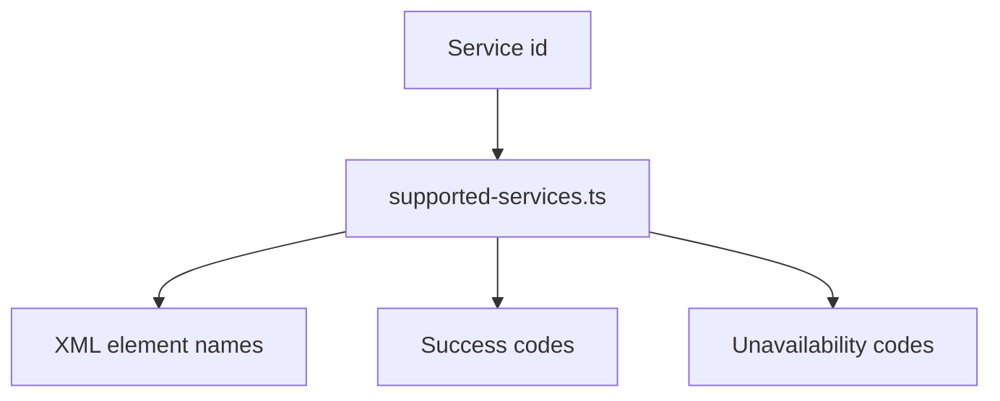

# src/canonical/transport/supported-services.ts

## Visao geral

Define os identificadores de servico SOAP suportados e o metadata estavel usado pelo slice inicial de transporte e pelo MVP operacional publicado.

## Responsabilidades

- Declarar os servicos publicados no primeiro slice.
- Associar nomes de elementos XML e codigos de status por servico.
- Registrar a cobertura homologada de autorizacao, consultas, manutencoes e servicos do destinatario sem duplicar regras por operacao.
- Centralizar o conhecimento para evitar duplicacao entre envelope, parser e classificacao.

## Entradas e saidas

- Entradas: um identificador `SupportedNFeSoapService`.
- Saidas: definicao estruturada do servico correspondente e a lista de placeholders ainda nao publicados, quando existir alguma.

## API / Assinatura

```ts
export function normalizeSupportedTransportService(
  service: string,
): SupportedNFeSoapService | undefined;

export function getSupportedTransportServiceDefinition(
  service: SupportedNFeSoapService,
): SupportedNFeSoapServiceDefinition;

export function getPlannedOperationalTransportServiceDefinitions(): readonly PlannedOperationalTransportServiceDefinition[];
```

## Fluxo principal



## Tratamento de erros e casos-limite

- O arquivo nao lanca erros diretamente.
- Apenas servicos suportados entram nas definicoes publicas do slice atual.
- A normalizacao retorna `undefined` quando o servico nao pertence ao slice inicial.
- Quando a expansao operacional publica uma nova operacao, ela deixa de aparecer como placeholder.
- A autorizacao trata `cStat` `100`, `103` e `104` como respostas bem-sucedidas para o mapeamento operacional do MVP.
- A consulta de situacao do documento trata `cStat` `100` como resposta bem-sucedida da troca SOAP.
- A inutilizacao trata `cStat` `102` como sucesso homologado.
- Cancelamento e carta de correcao tratam `cStat` `128` como sucesso do lote de evento no transporte.
- Distribuicao do destinatario e manifestacao reutilizam os ids `nfe-recipient-distribution` e `nfe-recipient-manifestation` com semantica nacional compartilhada.
- O slice `015` adiciona `nfce-authorization-pr` como identificador dedicado para manter a promocao de `PR` explicita sem alterar a facade root de `NFC-e`.
- O slice `016` adiciona diagnosticos suportados de contingencia para `svc-an` e `svc-rs`, mantendo `EPEC` e `offline` fora da lista de servicos promovidos.

## Exemplos

```ts
const service = getSupportedTransportServiceDefinition('nfe-status-service');
```

## Dependencias e integracoes

- `contracts.ts`
- `catalog-provenance.ts`
- `service-catalog.ts`
- `soap-envelope.ts`
- `transport-outcome-classification.ts`