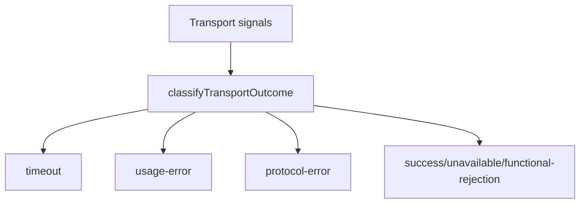

# src/canonical/transport/transport-outcome-classification.ts

## Visao geral

Classifica o resultado observavel de uma tentativa de transporte SOAP.

## Responsabilidades

- Traduzir timeout e erro de uso em categorias publicas imediatas.
- Usar `cStat` para distinguir sucesso, indisponibilidade e rejeicao funcional.
- Reservar `protocol-error` para respostas sem status aplicacional confiavel.

## Entradas e saidas

- Entradas: `TransportOutcomeClassificationInput`.
- Saidas: `TransportOutcomeClassification`.

## API / Assinatura

```ts
export function classifyTransportOutcome(
  input: TransportOutcomeClassificationInput,
): TransportOutcomeClassification;
```

## Fluxo principal



## Tratamento de erros e casos-limite

- O classificador nao lanca erro diretamente.
- `application-response` sem codigo conhecido cai em `functional-rejection`.

## Exemplos

```ts
const classification = classifyTransportOutcome({
  applicationStatusCode: '108',
  failureKind: 'application-response',
  service: 'nfe-status-service',
});
```

## Dependencias e integracoes

- `supported-services.ts`
- `execute-nfe-soap-service.ts`
- testes de unidade do slice de transporte